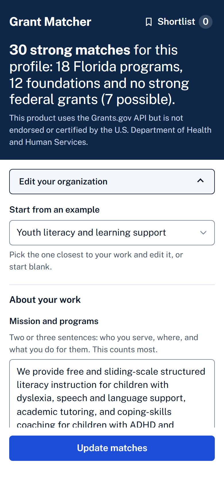
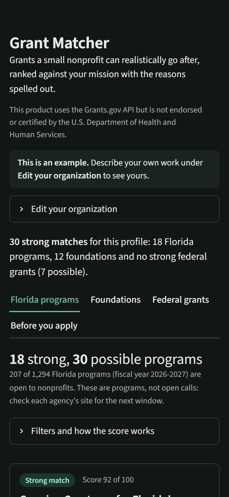

# Grant Matcher for small nonprofits

Finding grants you can actually win is hard when you are a small nonprofit. Grants.gov lists over a thousand open and upcoming federal opportunities at any time, and most of them are research programs, multimillion-dollar awards, or grants that require matching funds a young organization does not have. Foundation money is spread across tens of thousands of private funders whose interests are buried in tax returns.

Grant Matcher reads your mission and ranks three kinds of funding against it, telling you in plain words why each one is or is not a fit:

- **Federal grants:** every open and forecasted opportunity on Grants.gov that nonprofits can apply for
- **Foundations:** private foundations (IRS Form 990-PF) plus community foundations, public foundations, and United Ways (Form 990 Schedule I) that give in your state, with who they funded, typical grant size, and how to apply
- **Florida state programs:** state programs open to nonprofits from Florida's Catalog of State Financial Assistance, with legislative earmarks filtered out

**Try it:** [rendellrich.github.io/grant-matcher](https://rendellrich.github.io/grant-matcher/). It runs in your browser: your mission is never sent to a server.

> This product uses the Grants.gov API but is not endorsed or certified by the U.S. Department of Health and Human Services.


<table>
  <tr>
    <td width="50%" valign="top"></td>
    <td width="50%" valign="top"></td>
  </tr>
</table>

## What it does

- **Ranks by meaning, not just key words.** Your mission is compared with each opportunity's title, summary, and categories using a small semantic embedding model (BAAI/bge-small-en-v1.5 through fastembed, no GPU needed), plus coverage of your key words. Rare, specific words like "dyslexia" count for more than common ones like "children".
- **Checks the things that sink small applicants:**
  - eligibility for 501(c)(3) nonprofits, or for groups still waiting on status
  - cost sharing or matching requirements
  - minimum award sizes far larger than your budget
  - research grants that need a research institution
  - programs that list nonprofits but are really for tribes, state agencies, or embassy programs abroad
  - deadlines too close to meet
- **Explains every score** with reasons and cautions, so the ranking is a starting point for your judgment, not a black box.
- **Shows forecasts**, grants that are announced but not open yet, which give you the most time to prepare.
- **Exports** your strong and possible matches to CSV and the deadlines to a calendar file (.ics).
- **Narrows the list** without changing any score: search words across every result and its details, award size, deadline and agency for federal grants, agency for Florida programs, and for foundations their typical grant, whether they publish how to apply, whether they refuse unsolicited requests, and whether they're based in or fund your cities.
- **Marks what's new.** Grants, foundations and programs that weren't in the data at your last visit carry a New tag, and "Only new since your last visit" shows just those. The record of what you've seen stays in your browser.
- **Flags eligibility while your 501(c)(3) is pending.** Foundations whose own filing asks for 501(c)(3) status or an IRS determination letter get a caution and a lower score, with a note about a fiscal sponsor, and one checkbox hides them. Federal grants that require 501(c)(3) status say the same.
- **Keeps a shortlist** of the results you mark, saved in your browser on your device, with its own CSV. Each one has a stage: Saved, Applying or Submitted, with the date it moved. Submitted ones stop showing in the results and stay on the shortlist.
- **Saves your profile** as a small JSON file you can load next time. Nothing is stored on a server, so the profile clears when you close the page.

## How it runs

The public site is a static site in `web/` (Vite, TypeScript, Preact) on GitHub Pages, with no server of its own.

- **Matching happens in the browser.** The first time you search with your own mission, the page downloads the same embedding model the data pipeline uses (BAAI/bge-small-en-v1.5, about 67 MB, once) and runs it on your device with [transformers.js](https://github.com/huggingface/transformers.js). Your mission, key words and profile never leave the page. The three examples are scored without the download.
- **The scoring is the Python scoring, ported.** `web/src/score.ts` is a line-by-line TypeScript port of `grantmatch/match.py` and `grantmatch/rank_more.py`. A parity test scores nine example profiles in both and requires the same results, reasons and cautions.
- **The data is published with the site.** After each refresh, `grantmatch/export_web.py` writes the records and their embeddings (as float16) for the browser, and the deploy workflow rebuilds the site.

## Design and accessibility

The people using this are often one-person development teams at small nonprofits, working late, on a phone as often as a laptop, and some use a screen reader. The design follows from that.

- **It reads like a funding directory.** The look is modelled on the printed grant catalogs nonprofits used to find at the library: a navy band, Public Sans (the typeface of U.S. government sites) for working text, a serif for funder names, and ruled entries that each lead with their catalog number, EIN or opportunity number.
- **The answer comes first.** The first line on the page says how many strong matches there are and where. Each tab carries its count, and each entry leads with a Strong, Possible or Long shot label and its score on the same 0 to 100 scale, with the 35 and 60 marks drawn in, so entries compare at a glance. Deadlines sit right-aligned.
- **Every entry explains itself** in the same order: what fits your work, then cautions, then plain facts such as typical grant size, in a quieter color. If none of your key words appear in a funder's past grants, that is the first caution.
- **Nothing changes until you ask.** Edits to the profile stay a draft until you press Update matches. The button stays pinned at the bottom of the form, and a line under it confirms the update or says your changes are not applied yet.
- **One accent color.** Blue is the only accent. Amber marks cautions and red marks errors; neither is used for decoration. Light and dark follow the visitor's system setting, and text meets WCAG AA contrast in both.
- **Works by keyboard and on small screens.** Focus is always visible, controls have 44 pixel targets, each long list has a link to skip past it, and the layout works down to 320 pixels wide with no sideways scrolling.
- **Tested with a screen reader.** I ran the main tasks with NVDA 2026.3 in Microsoft Edge and fixed what it found. Pressing Update matches is now announced. Show more keeps focus in place instead of sending NVDA back to the top. Each card's title is read before its score, and the button that opens a card's details names that card.

The colors, type, components and rules are written down in [DESIGN.md](DESIGN.md).

## Private workspace (optional)

The Streamlit app (`app.py`, at [grant-matcher.streamlit.app](https://grant-matcher.streamlit.app)) still runs and has a signed-in workspace for an organization's own team. It is off unless the deployment has the secrets in `.streamlit/secrets.toml.example`. With them, people on the allowed list can sign in with Google and get:

- **Pipeline:** save any grant, foundation, or state program, then track status, deadlines, next steps, and notes
- **Organization:** the facts every draft draws on (mission, programs, budget, outcomes, board)
- **Write:** a letter of inquiry drafted for a saved funder from what it funded last year, or an uploaded application form with every question drafted, editable, and exported to Word (for a Word form, the answers are placed into a copy of the funder's own file)
- **Answer library:** every answer you approve is saved and reused in the next draft, so drafts sound more like you over time

Saved work lives in a separate private GitHub repository, not in this public one. Drafting uses the Claude API; drafts use only saved facts and approved answers, and missing facts become [bracketed placeholders] rather than guesses.

## How the federal score works

| Part | Effect |
|---|---|
| Mission similarity | Up to 70 points, by how far a grant sits above your mission's typical similarity to all grants |
| Key word coverage | Up to 30 points, weighted toward your rarest key words |
| "Other" eligibility only | minus 5, with a note to read the eligibility text |
| Requires 501(c)(3) and you do not have it | minus 40 |
| Requires cost sharing you cannot provide | minus 20 |
| Smallest award over 3 times your annual budget | minus 15 |
| Research grant (NIH or NSF announcement, or "research" in the title) | minus 35 |
| Aimed at tribes, state agencies, or overseas embassy programs | minus 20 to 25 |
| Research and development only | minus 8 |

Scores of 60 and up are labeled Strong, 35 to 59 Possible, and below 35 Long shot.

## How foundations are scored

| Part | Effect |
|---|---|
| Past grant purposes match your mission | Up to 60 points |
| Your key words in its past grants | Up to 15 points |
| Share of its grants that went to your state | Up to 20 points |
| Funded groups in the cities you list | plus 5, or plus 10 for three or more |
| Based in one of your cities | plus 5 |
| Community foundation serving your area | plus 15 |
| Community foundation in another state | minus 25 |
| Gives mostly outside your state (under 10% of grants) or not at all | minus 15 to 20 |
| Fewer than three grants last year | minus 20, and never rated Strong |
| Typical grant larger than your annual budget | minus 10 |
| Says it does not accept unsolicited requests | minus 30 |
| Mostly scholarships for individuals | minus 15 |

Foundations that check the box saying they only fund preselected organizations are hidden unless you ask to see them.

## Florida state programs

Florida's Department of Financial Services keeps the Catalog of State Financial Assistance, a list of every state program that pays money to local governments, nonprofits, and businesses. Many entries are money the Legislature set aside for a named organization; those are flagged and hidden by default. The catalog lists programs rather than open calls, so each result links to the agency for its next application window.

## Data

A GitHub Action runs twice a day and pulls every posted and forecasted opportunity open to nonprofits (eligibility codes 12, 13, 25 and 99) from the public [Grants.gov API](https://www.grants.gov/api/api-guide) using `search2` and `fetchOpportunity`. No API key is needed. The cleaned file and the opportunity embeddings are published as `data-latest` release assets, and the app reads them from there. A snapshot in `data/` is the fallback. If the embedding model cannot load, the app falls back to TF-IDF similarity.

| Source | Refresh | Job |
|---|---|---|
| Grants.gov (`search2`, `fetchOpportunity`) | twice a day | `refresh-data.yml` |
| IRS Form 990-PF e-file XML ([Form 990 series downloads](https://www.irs.gov/charities-non-profits/form-990-series-downloads)), latest return per foundation, split by state, every state | monthly | `refresh-foundations.yml` |
| IRS Form 990 Schedule I for organizations the [Exempt Organizations Business Master File](https://www.irs.gov/charities-non-profits/exempt-organizations-business-master-file-extract-eo-bmf) codes T31 (community foundations), T30 (public foundations), and T70 (United Ways and federated funds) | monthly | `refresh-foundations.yml` |
| Florida [Catalog of State Financial Assistance](https://apps.fldfs.com/fsaa/catalog.aspx), current fiscal year | weekly | `refresh-florida.yml` |

## Run it yourself

```bash
pip install -r requirements.txt
python -m grantmatch.fetch --out data/opportunities.json.gz   # about 20 minutes; add --limit 50 for a quick test
python -m grantmatch.embed federal data/opportunities.json.gz data/embeddings.npz
pip install -r requirements-data.txt
python -m grantmatch.foundations --years 2025,2026 --out data/foundations      # about 15 minutes, 7 GB of downloads
python -m grantmatch.embed foundations data/foundations/FL.json.gz data/foundations/FL.npz
python -m grantmatch.community --years 2025,2026 --out data/community          # about 5 minutes
python -m grantmatch.embed foundations data/community/FL.json.gz data/community/FL.npz
python -m grantmatch.florida --out data/florida.json.gz                        # about 25 minutes
python -m grantmatch.embed florida data/florida.json.gz data/florida.npz
python -m pytest -q

# the public site
python -m grantmatch.export_web web/public/data   # add --local to use only the snapshot in data/
cd web
npm ci
npm run model    # puts the matching model beside the site
npm run dev

# the parity test: Python's scores for the examples, then the same profiles in TypeScript
python -m grantmatch.export_web web/test-data --local --golden web/test-data/golden.json
cd web && npm test

# the Streamlit app and workspace
streamlit run app.py
```

## Project layout

```
web/                    the public site: Preact app, TypeScript scoring, parity test
grantmatch/export_web.py  data and embeddings for the site, and Python's scores for the parity test
app.py                  Streamlit app (public search and the signed-in workspace)
grantmatch/fetch.py     Grants.gov pull and cleanup
grantmatch/embed.py     semantic embeddings (twice a day for grants, on demand for a mission)
grantmatch/embed_states.py  foundation embeddings for every state: each foundation once, reused between runs
grantmatch/match.py     federal scoring, reasons, calendar export
grantmatch/foundations.py  IRS 990-PF parsing, split by state
grantmatch/community.py IRS 990 Schedule I for community foundations and United Ways
grantmatch/florida.py   Florida Catalog of State Financial Assistance
grantmatch/rank_more.py foundation and Florida scoring
grantmatch/store.py     private workspace storage (GitHub repo or local folder)
grantmatch/workspace.py pipeline, organization facts, answer library, documents
grantmatch/writer.py    Claude drafting, Word export, and form filling
grantmatch/ui_workspace.py  workspace screens
tests/                  unit tests for scoring and parsing
PRODUCT.md              who it's for and the product's rules
DESIGN.md               design system: colors, type, components, and accessibility rules
docs/images/            README screenshots
.github/workflows/      data refreshes, tests, and the site deploy
```

## Roadmap

- More states' grant catalogs
- Email digest of new matches each week

## Why I built it

I'm a data scientist and the CTO of Exceed the Odds, a founding-stage nonprofit that provides literacy, speech, and tutoring support to children at no cost or on a sliding scale. We fund that work with grants, and I wanted a faster way to find the ones worth our time.

Built by [Rendell Rich](https://rendellrich.github.io). MIT License.
